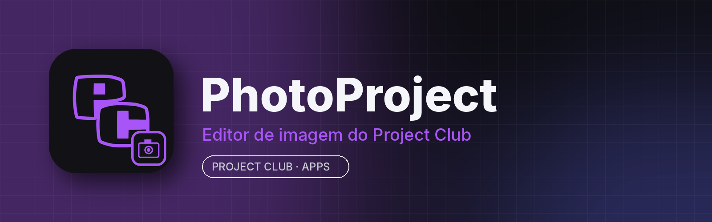

<p align="center"></p>

# PhotoProject

**PhotoProject** é o editor de imagem do **Project Club**: retoque fotos, monte artes com camadas, edite arquivos do Photoshop (PSD/PSB) e automatize tarefas, com a cara do Project Club e integrado à aba **Apps** do app para computador.

É baseado no **[Patchy Image Editor](https://www.rtsoft.com/patchy/)**, de código aberto sob a licença MIT. Todos os recursos do Patchy continuam aqui; o PhotoProject troca o nome e o ícone e faz a integração com o Project Club.

## Principais recursos

- Abre e salva PSD/PSB com camadas, máscaras, estilos de camada, texto e vetores editáveis
- Smart Objects e Smart Filters, ajustes não destrutivos e modos de mistura
- Pincéis, seleção, recorte, clonagem, correção (healing), liquify, warp e gradientes
- Texto e formas vetoriais editáveis
- Camera RAW, HEIF/AVIF, WebP, JPEG XL, TIFF, PNG, SVG e PDF
- Plug-ins 8BF antigos, scripts em JavaScript e automação pela linha de comando
- Controle por agentes de IA locais (conector MCP), opcional

## Instalar

Pelo **Project Club** (recomendado): aba **Apps → PhotoProject → Instalar**. As atualizações chegam por lá.

Manual: baixe em [Releases](../../releases/latest):
- **Windows 10/11 (64 bits):** `photoproject-<versão>-win.zip` → extraia e abra `PhotoProject.exe`
- **Linux (x86_64):** `photoproject-<versão>-linux.AppImage` → `chmod +x *.AppImage && ./photoproject-*.AppImage`

## Requisitos

| | Mínimo | Recomendado |
|---|---|---|
| Sistema | Windows 10 64 bits / Linux x86_64 (glibc 2.35+) | Windows 11 / Ubuntu 22.04+ |
| CPU | 2 núcleos com SSE4.1 | 4 núcleos ou mais |
| RAM | 4 GB (o app usa ~300 MB–2 GB conforme a imagem) | 8–16 GB para PSDs grandes |
| GPU | OpenGL 3.3 | GPU dedicada ou integrada recente |
| Disco | ~250 MB para o app + espaço das imagens | SSD |

## Compilar

C++20, CMake e Qt 6 (veja [docs/release-process.md](docs/release-process.md) e [docs/platform.md](docs/platform.md)):

```bash
git clone https://github.com/RiqueBitt/PhotoProject
cd PhotoProject
cmake --preset linux-release && cmake --build --preset linux-release   # no Windows: --preset release
```

Para gerar os pacotes publicados no Project Club, rode o workflow **Build PhotoProject release** (Actions → *Run workflow*, informando a versão). Ele compila Windows e Linux e publica a release `vX.Y.Z` **neste repositório**.

## Créditos e licença

PhotoProject é uma versão modificada do **Patchy Image Editor**, © 2026 Seth A. Robinson, distribuída sob a **licença MIT** (veja [LICENSE](LICENSE)). As bibliotecas de terceiros e suas licenças estão em [NOTICE-THIRD-PARTY.md](NOTICE-THIRD-PARTY.md) e em `third_party/`. O PhotoProject não é afiliado ao Patchy nem à Adobe; Photoshop é marca da Adobe. O README original está em [docs/README-Patchy-original.md](docs/README-Patchy-original.md).
